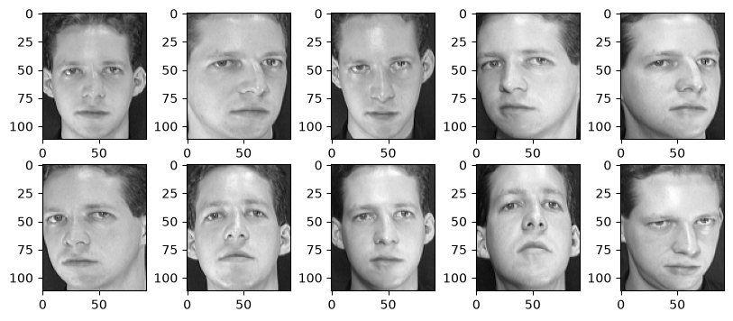
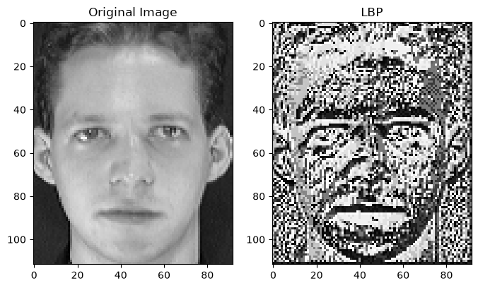
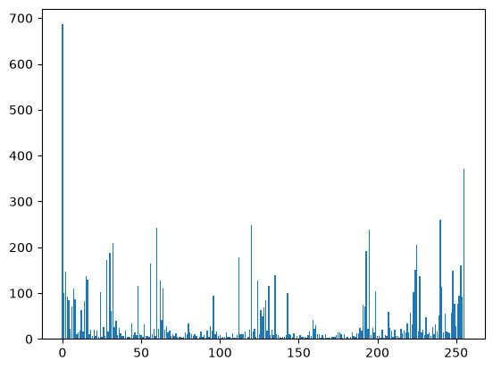
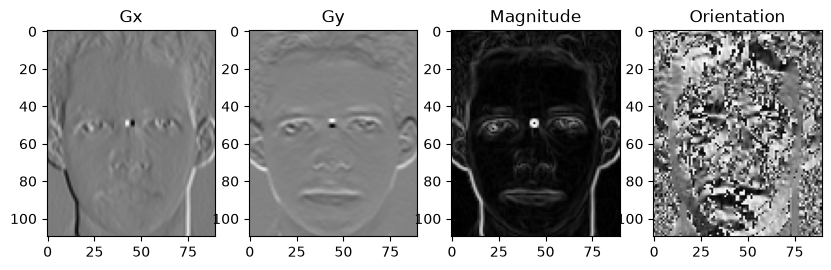
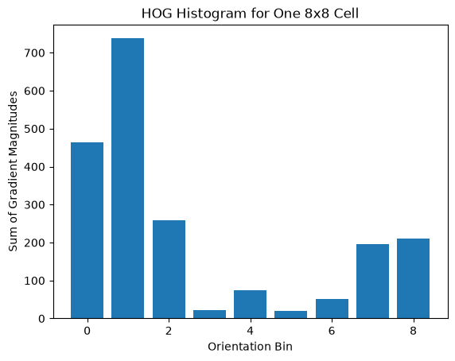
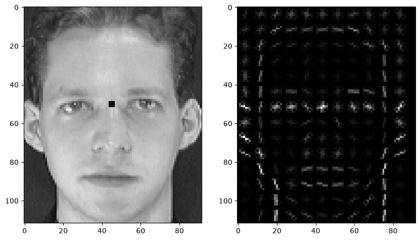

# Face Feature Extraction with LBP and HOG

A hands-on computer vision notebook exploring two classical image features—**Local Binary Patterns (LBP)** and **Histogram of Oriented Gradients (HOG)**—using grayscale face images from the AT&T/ORL face dataset.

## Overview

This project covers:

- Loading `.pgm` face images and inspecting their pixel matrices.
- Visualizing a gallery of face images.
- Computing an LBP feature map and an LBP histogram.
- Calculating a local LBP code for a selected `3 × 3` patch.
- Computing image gradients with Sobel kernels (`Gx`, `Gy`), gradient magnitude, and orientation.
- Building a magnitude-weighted, 9-bin orientation histogram for an `8 × 8` HOG cell.
- Combining four cell histograms into a 36-value block and applying L2 normalization.
- Comparing a simplified manual HOG implementation with the `scikit-image` HOG implementation.

## Example results

### Face image gallery



### Local Binary Patterns

LBP describes local texture by comparing neighboring pixel intensities with the center pixel. The notebook displays the original face beside its LBP map and plots the distribution of LBP values.





### HOG gradients and cell histogram

HOG describes local shape using gradient orientations weighted by gradient magnitude. The notebook calculates horizontal and vertical gradients, gradient magnitude, and orientation before accumulating a 9-bin histogram for an `8 × 8` cell.





### HOG visualization

The library visualization highlights the local gradient structure of the face.



The notebook also compares the manually calculated block descriptor with the library feature vector.

## Requirements

Python 3.9+ is recommended. Install the required packages:

```bash
pip install numpy matplotlib opencv-python scikit-image jupyter
```

## Dataset setup

Download and extract the **AT&T/ORL Face Database**. Place the `att_faces` directory alongside the notebook, preserving the subject-folder structure:

```text
project/
├── final.ipynb
├── README.md
├── assets/
└── att_faces/
    ├── s1/
    │   ├── 1.pgm
    │   ├── 2.pgm
    │   └── ...
    ├── s2/
    └── ...
```

The notebook currently reads `att_faces/s1/1.pgm` and displays the first ten images from `s1`. Change the `subject` and image filename variables to inspect other images. The dataset is not included in this repository; obtain it separately and follow its applicable terms.

## Run the notebook

```bash
jupyter notebook final.ipynb
```

Run the cells from top to bottom. The dataset must be in the expected location for image-loading cells to work.

## How the features work

### LBP

1. Select a pixel and its `3 × 3` neighborhood.
2. Compare neighboring intensities with the center intensity.
3. Convert comparisons into binary values and encode them as an integer.
4. Repeat across the image to form an LBP feature map, then calculate a histogram.

### HOG

1. Compute horizontal and vertical gradients using Sobel filters.
2. Calculate gradient magnitude and unsigned orientation.
3. Divide the image into `8 × 8` cells.
4. Accumulate gradient magnitudes into nine orientation bins per cell (20° per bin over 0°–180°).
5. Concatenate the histograms of four adjacent cells into a 36-value block and normalize the block.
6. Compare the simplified implementation with `skimage.feature.hog`.

## Implementation notes

- The notebook contains both library-based feature extraction and manual implementations intended for learning.
- The manual HOG code uses hard assignment to one orientation bin per pixel. Standard HOG implementations may interpolate between bins and use different gradient and normalization details, so numerical values are not expected to match exactly.
- For a fair numerical comparison, use the same number of orientations in both implementations. The notebook's library example currently uses `orientations=8`, while the manual cell histogram uses 9 bins; change the library parameter to `orientations=9` if you want to compare like-for-like settings.
- The manual gradient-orientation calculation can produce divide-by-zero warnings when `Gx` is zero. A more robust calculation is `np.degrees(np.arctan2(gy, gx)) % 180`.
- This is an educational feature-extraction notebook, not a trained face-recognition or identity-classification system.

## Technologies

- Python
- NumPy
- OpenCV
- Matplotlib
- scikit-image
- Jupyter Notebook

## License

Add a license file before distributing or reusing this project. Check the dataset's terms separately before redistributing any face images.
